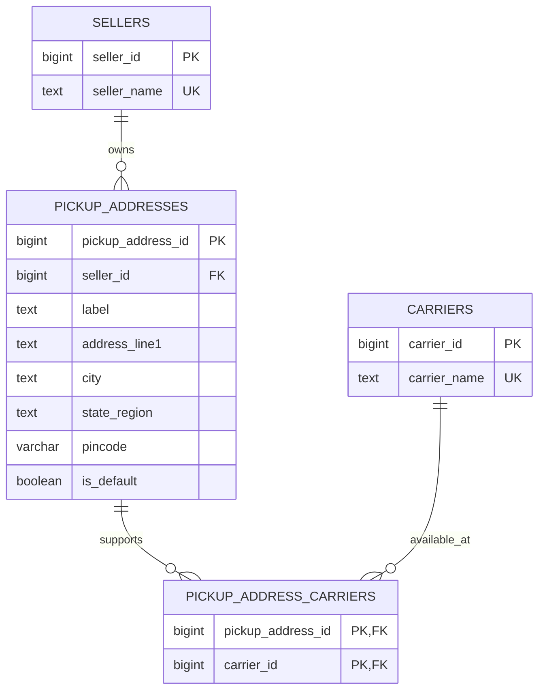

# Pickup-address normalization and ERD

## Flat-table anomalies

Assume the original flat row contains seller details, a pickup address, and a
carrier. When one seller has multiple addresses or an address supports multiple
carriers, seller and address values are repeated across rows.

- **Update anomaly:** changing a seller name or address requires updating every
  repeated row; missing one leaves contradictory data.
- **Insert anomaly:** a seller with no pickup address (such as New Seller Ltd)
  cannot be recorded without inventing a pickup/carrier row. A carrier or
  address also cannot be recorded independently of a seller row.
- **Delete anomaly:** deleting the last address/carrier row for a seller also
  deletes the only copy of that seller's details. Deleting one carrier row can
  also accidentally remove the only copy of an address.

The design below separates sellers, addresses, and carriers; the junction table
represents the many-to-many relationship between addresses and carriers.

## Normalized design

`pickup_addresses.seller_id` references `sellers.seller_id`; deleting a seller
cascades to that seller's addresses. The junction table has a composite primary
key, so a carrier cannot be assigned twice to the same address. A unique
constraint on `(seller_id, label)` prevents duplicate labels for one seller.
The partial unique index `pickup_addresses_one_default_per_seller_idx` permits
at most one address with `is_default = true` for each seller.

The database and sample data are in [`pickups.sql`](./pickups.sql).
