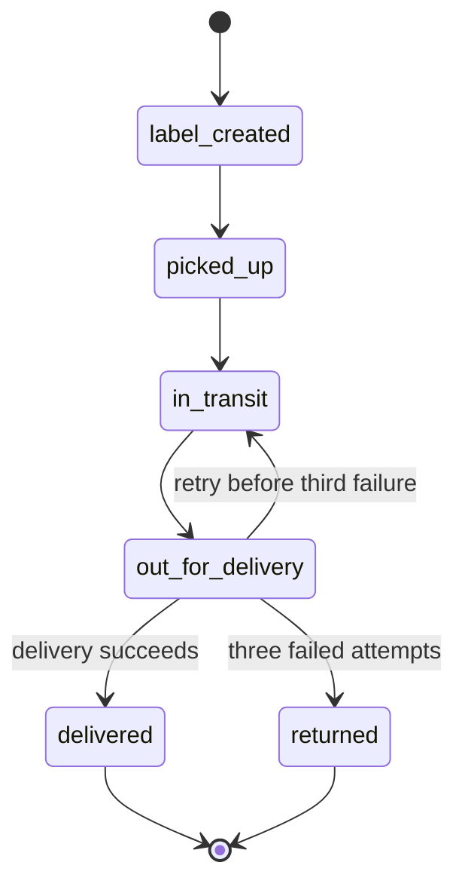

# Day 13 — Return to sender

## Design and state machine

`returned` is a shipment state reachable only from `out_for_delivery` after the
shipment has three recorded failed delivery attempts. It is final: no shipment
state transitions are allowed out of `returned`. Before the third failure, an
attempt may move the shipment back to `in_transit` for another delivery run.



The enforced shipment-flow rows are:

```js
out_for_delivery: ['in_transit', 'delivered', 'returned'],
delivered: [],
returned: []
```

`move(current, next, SHIPMENT_FLOW, { failedDeliveryAttempts })` guards the
return edge as well as validating the graph. The API increments attempts only
while `out_for_delivery`; the request cannot submit an arbitrary attempt count.
The single transition helper is also used for order-status updates.

## Order status decision

When a shipment reaches `returned`, its order becomes `Returned`, rather than
remaining `Shipped`. The seller can filter for `Returned` to distinguish an
undelivered parcel entering the return-to-seller path from a parcel still in
transit to the customer. The customer also sees that delivery did not complete
and that the parcel is being returned, instead of an indefinitely misleading
`Shipped` status. `Returned` is terminal, so fulfillment cannot silently
reopen a completed return; a new shipment requires a new order.

The relevant order-flow rows and shipment-to-order mapping are:

```js
Shipped: ['Delivered', 'Returned'],
Delivered: [],
Returned: []

ORDER_STATUS_FOR = {
  label_created: 'Processing',
  picked_up: 'Shipped',
  in_transit: 'Shipped',
  out_for_delivery: 'Shipped',
  delivered: 'Delivered',
  returned: 'Returned'
}
```

The existing order state machine, Mongoose enum, order API validation, web
status type, status filter, summary, and terminal action state now include
`Returned`. Direct order PATCH requests cannot set `Returned`; that status is
updated only by a guarded shipment transition.

## API

Create a shipment for an existing Pending or Processing order:

```http
POST /shipments
Content-Type: application/json

{"orderId":"ORD-123"}
```

Move it through `picked_up`, `in_transit`, and `out_for_delivery` using
`POST /shipments/:id/move` with `{"next":"..."}`. Record each failed delivery
with `POST /shipments/:id/failed-attempts`. Once the persisted count is three,
the return transition succeeds; the API examples are in
[`evidence.md`](./evidence.md).

## Local API walkthrough

From the repository root, start the Compose stack. The environment assignment
uses the local mock key; use your configured value if you already set one:

```bash
ROAD_RUNNER_API_KEY=local-demo-key docker compose up -d --build --wait --wait-timeout 180
```

Create an order and note its returned `id`, then use that ID to create a
shipment and note the shipment `id`:

```bash
curl -i -X POST http://localhost:3002/orders \
  -H 'Content-Type: application/json' \
  -d '{"customer":"RTS test","product":"Sample parcel"}'

curl -i -X POST http://localhost:3002/shipments \
  -H 'Content-Type: application/json' \
  -d '{"orderId":"ORD-ID-FROM-RESPONSE"}'
```

For that shipment ID, move to delivery and record three failed attempts:

```bash
curl -i -X POST http://localhost:3002/shipments/SHP-ID-FROM-RESPONSE/move \
  -H 'Content-Type: application/json' -d '{"next":"picked_up"}'
curl -i -X POST http://localhost:3002/shipments/SHP-ID-FROM-RESPONSE/move \
  -H 'Content-Type: application/json' -d '{"next":"in_transit"}'
curl -i -X POST http://localhost:3002/shipments/SHP-ID-FROM-RESPONSE/move \
  -H 'Content-Type: application/json' -d '{"next":"out_for_delivery"}'
for attempt in 1 2 3; do
  curl -i -X POST http://localhost:3002/shipments/SHP-ID-FROM-RESPONSE/failed-attempts
done
```

Now run the return and refused-transition requests from
[`evidence.md`](./evidence.md). Both the state-machine and route test commands
below can also run without starting MongoDB.

## Tests

Run the state-machine and HTTP route tests without MongoDB:

```bash
node --test shiphub-api/tests/fulfilment-flows.test.js shiphub-api/tests/fulfilment-routes.test.js
```

Run the web type-check and tests after adding the `Returned` status:

```bash
npm --prefix shiphub-web run check
```

The tests and what they protect:

- `allows return only from out_for_delivery after three failed attempts` —
  confirms the legal return edge.
- `rejects picked_up directly transitioning to returned` — rejects a skipped
  delivery path.
- `returned is terminal and has no outgoing transitions` — protects finality.
- `every shipment state is reachable from label_created` — detects orphaned
  states.
- `every shipment transition maps to a valid order transition` — checks the
  two flows remain consistent.
- `rejects a return before the third failed attempt` — regression test for the
  missing transition guard.
- `returns a shipment after three failed attempts and updates the order` —
  verifies HTTP 200 and order synchronization.
- `refuses a transition out of returned with HTTP 409` — verifies the terminal
  state API response.
- `refuses API return before the third failed attempt` — verifies the HTTP
  guard.
- `records failed attempts server-side only while out_for_delivery` — verifies
  callers cannot supply the attempt count.

## Reflection

I chose a new `Returned` order status instead of keeping the order `Shipped`, because the existing status would hide the failed delivery outcome. The seller can identify returned orders for follow-up, and the customer sees that the parcel is being sent back rather than still heading toward them. I made `Returned` terminal and required three persisted failed attempts before allowing the shipment transition, so neither the API caller nor a later retry can bypass the return policy.
